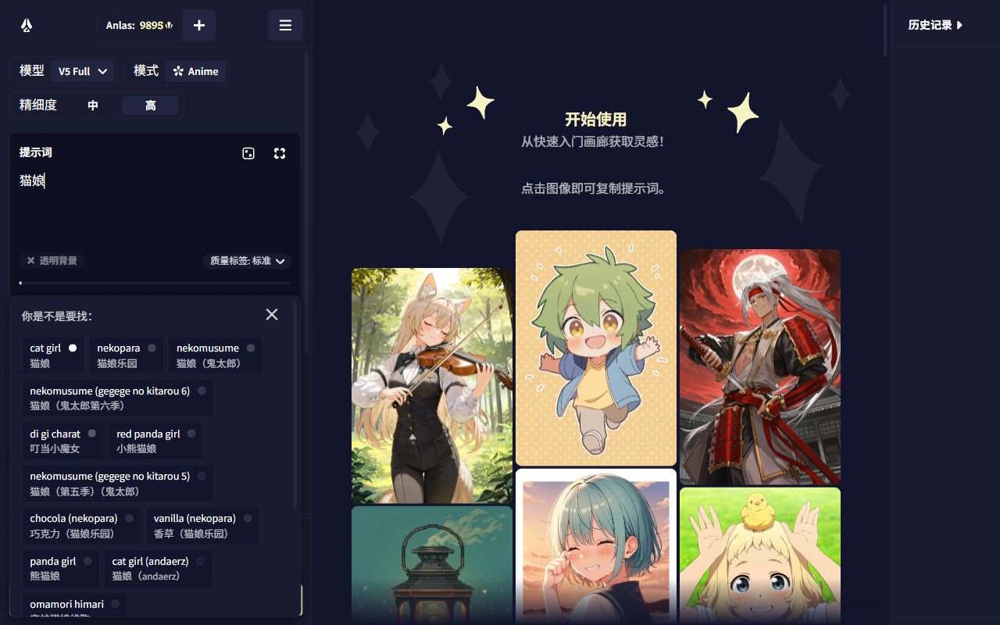
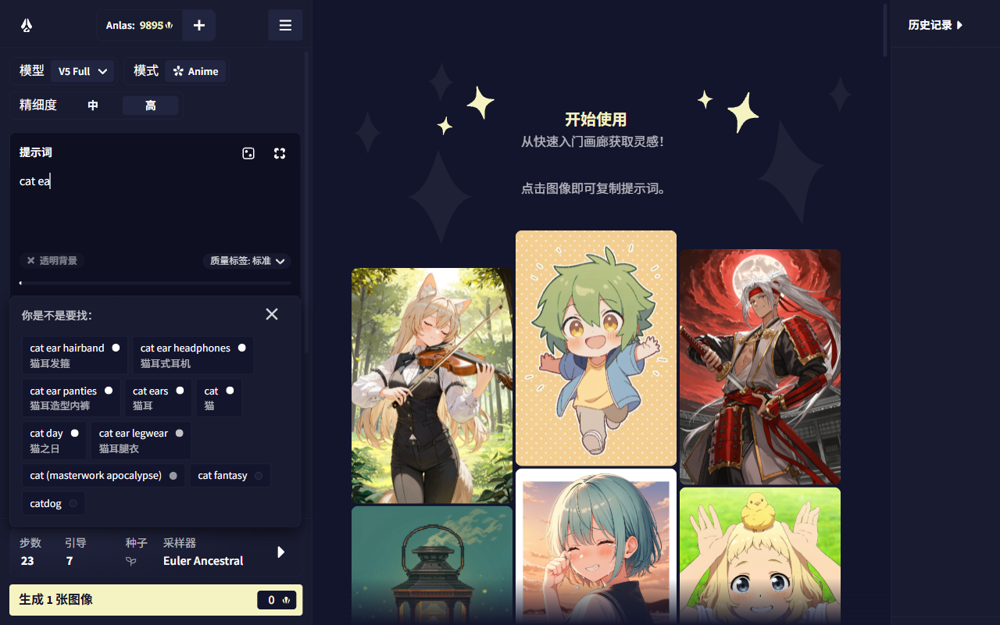
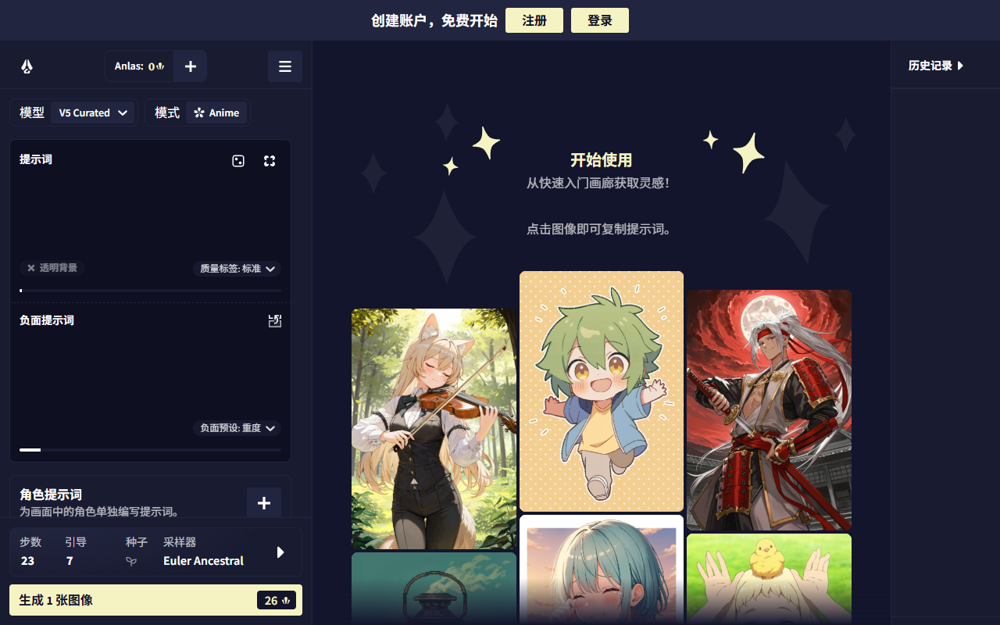
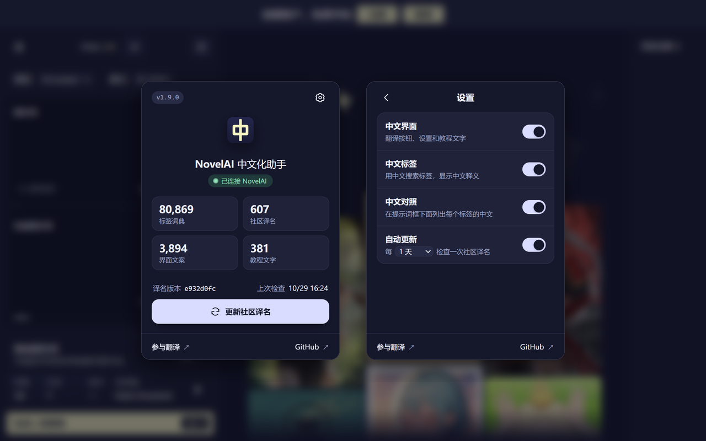

<div align="center">


# NovelAI中文化助手

**让中文用户用起 NovelAI 更顺手**

在提示词框里打中文就能联想英文标签，英文标签附上中文释义，界面和教程也能切换成中文。

<a href="https://chromewebstore.google.com/detail/mbkdadfailijiglghflchpbmoofmohah"></a>&nbsp;&nbsp;<a href="https://addons.mozilla.org/addon/novelai%E4%B8%AD%E6%96%87%E5%8C%96%E5%8A%A9%E6%89%8B/"></a>

[](https://chromewebstore.google.com/detail/mbkdadfailijiglghflchpbmoofmohah)
[](https://addons.mozilla.org/addon/novelai%E4%B8%AD%E6%96%87%E5%8C%96%E5%8A%A9%E6%89%8B/)
[](https://raw.githubusercontent.com/TomorrowX6/NovelAI-CN/main/dist/novelai-zh-tags.user.js)
[](https://github.com/TomorrowX6/NovelAI-CN/releases)
[](https://github.com/TomorrowX6/NovelAI-CN/actions/workflows/ci.yml)

[功能](#功能) · [安装](#安装) · [使用](#使用) · [参与标签翻译](#参与标签翻译) · [已知限制](#已知限制) · [开发](#开发) · [数据来源与许可](#数据来源与许可)

<sub>非官方项目，与 NovelAI 及其开发商 Anlatan 无关。</sub>

</div>

同一份代码有三种装法：Chrome 扩展和 Firefox 附加组件「NovelAI中文化助手」，以及用户脚本「NovelAI 中文标签联想」（Tampermonkey / Violentmonkey）。标签词典和界面译文都打包在里面，联想和翻译在浏览器里完成，不收集个人信息（见[隐私政策](PRIVACY.md)）。

## 功能

<table>
  <tr>
    <td colspan="2" align="center">
      <br>
      <sub>输入「猫娘」，联想出 cat girl、nekopara 等英文标签</sub>
    </td>
  </tr>
  <tr>
    <td width="50%" align="center">
      <br>
      <sub>英文联想的每一项附上中文释义</sub>
    </td>
    <td width="50%" align="center">
      <br>
      <sub>按钮、设置和教程显示为中文</sub>
    </td>
  </tr>
</table>

- 🔍 **用中文找标签**：在生图页（novelai.net/image）的提示词框里输入「猫娘」「黑丝」「七分身」这样的中文，会联想出 cat girl、black thighhighs、cowboy shot 等英文标签，点选或用方向键 + 回车插入。繁体中文也能识别。
- 📖 **看懂英文标签**：输入英文时，NovelAI 自带联想的每一项下面多一行中文。
- 📋 **标签中文对照**：点提示词框上的「中」按钮，框下面列出提示词里每个标签的中文，别人分享的提示词也能一眼看懂；点一项就在提示词里选中它。
- 🌐 **界面汉化**：语言选单里多了「中文」，按钮、设置、提示和生图、写作教程都显示为中文。
- ✏️ **自动修正中文标点**：NovelAI 只把半角逗号当作标签分隔符，中文输入法打出的「，」会被转成 `, `，否则「长发，猫耳」会被当成一个标签。权重写法 `1.2::标签::` 里的「：」也会转成 `:`。
- 🤝 **社区译名**：任何人都可以在 [NovelAI Tag Editor](https://novelai.000.moe) 用 GitHub 登录后修改标签的中文译名和检索词，脚本和扩展默认每天从 GitHub 拉取一次。

## 安装

| 方式 | 从哪里装 | 要求 |
| --- | --- | --- |
| [Chrome 扩展](#chrome-扩展) | [Chrome 应用商店](https://chromewebstore.google.com/detail/mbkdadfailijiglghflchpbmoofmohah) | Chrome 111 或更新 |
| [Firefox 附加组件](#firefox-附加组件) | [Firefox 附加组件站](https://addons.mozilla.org/addon/novelai%E4%B8%AD%E6%96%87%E5%8C%96%E5%8A%A9%E6%89%8B/) | Firefox 140 或更新（安卓版 142） |
| [用户脚本](#用户脚本) | [novelai-zh-tags.user.js](https://raw.githubusercontent.com/TomorrowX6/NovelAI-CN/main/dist/novelai-zh-tags.user.js) | Tampermonkey 或 Violentmonkey |

> [!NOTE]
> 几种方式选一种，不要同时启用。应用商店里的 Chrome 扩展和从 Releases 手动加载的扩展 ID 不同，是两个扩展，换装时先移除原来那个。

### Chrome 扩展

需要 Chrome 111 或更新的版本。

从 [Chrome 应用商店](https://chromewebstore.google.com/detail/mbkdadfailijiglghflchpbmoofmohah) 安装，装好后刷新 NovelAI 页面。之后扩展会随应用商店自动更新。

<details>
<summary>打不开 Chrome 应用商店时：手动安装</summary>

1. 在 [Releases](https://github.com/TomorrowX6/NovelAI-CN/releases) 下载最新的 `novelai-zh-tags-版本.zip` 并解压。
2. 打开 `chrome://extensions`，打开右上角的「开发者模式」，点「加载已解压的扩展程序」，选解压出来的文件夹。
3. 刷新 NovelAI 页面。

这样装的扩展不会自动更新。出新版时，下载新的 zip 覆盖到同一个文件夹，再在扩展页点刷新按钮。

Releases 里的 `.crx` 是自签名的安装包：Windows 和 macOS 上的 Chrome 只接受应用商店签名的 .crx，拖进去会报 `CRX_REQUIRED_PROOF_MISSING`，它只适合通过企业策略部署，或在允许这类安装包的浏览器里使用。

</details>

### Firefox 附加组件

需要 Firefox 140 或更新的版本（安卓版 142）。

从 [Firefox 附加组件站](https://addons.mozilla.org/addon/novelai%E4%B8%AD%E6%96%87%E5%8C%96%E5%8A%A9%E6%89%8B/) 安装，桌面版和安卓版都可以，装好后刷新 NovelAI 页面。之后附加组件会自动更新。

<details>
<summary>临时载入 Releases 里的版本</summary>

在 [Releases](https://github.com/TomorrowX6/NovelAI-CN/releases) 下载 `novelai-zh-tags-版本-firefox.zip`，打开 `about:debugging#/runtime/this-firefox`，点「临时载入附加组件」，选这个 zip。临时载入的附加组件在关闭 Firefox 后会被移除；正式版 Firefox 只能长期安装经过 Mozilla 签名的附加组件。

</details>

### 用户脚本

1. 安装 [Tampermonkey](https://www.tampermonkey.net/) 或 Violentmonkey。新版 Chrome 还要在扩展详情页打开「允许运行用户脚本」（或在 `chrome://extensions` 打开开发者模式），否则脚本不会运行。
2. 打开 <https://raw.githubusercontent.com/TomorrowX6/NovelAI-CN/main/dist/novelai-zh-tags.user.js>，在脚本管理器弹出的安装页点安装。也可以在 Tampermonkey 里「添加新脚本」，粘贴整个文件内容后保存。
3. 刷新 NovelAI 页面。

脚本管理器会定期检查 main 分支上的新版本并自动更新，也可以手动「检查更新」。1.3.0 及更早的版本没有更新地址，要手动升级一次：用新文件内容替换原脚本。

## 使用

### 标签联想

在提示词框里输入两个字以上的中文就会出现联想（NovelAI 只在片段长度为 2–20 个字符时请求联想，单字不会触发）。联想面板、点选和键盘操作都是 NovelAI 自己的，插入的是英文标签。含假名的日文输入原样交给 NovelAI 处理。

### 标签中文对照


点提示词框标题栏右侧的「中」按钮，框下面会列出提示词里的每个标签和它的中文，再点一次关掉。基础提示词、负面提示词和角色提示词的框上都有这个按钮，开关对所有框生效，刷新后保持。扩展面板设置里的「中文对照」是同一个开关，在那里改也当场生效。

- 提示词改了，对照跟着更新。权重写法 `1.2::标签::` 和 `{}`、`[]` 会去掉，`source#hug` 这类动作标签按 `#` 后面的部分查，重复的标签只列一次。
- 词典里没有中文的（画师、自然语言描述、冷门标签）暗着显示，可以到[编辑器](https://novelai.000.moe)里补上译名。
- 点对照里的一项，提示词里对应的那段文字会被选中，直接打字就能替换，按退格就能删掉。

### 界面汉化

在左侧菜单最下方的语言选单里选 ZH，或在「用户设置 → 界面 → 界面语言」里选「中文」，切回 EN、JP 也在同一处。

- 覆盖 NovelAI 界面文案的全部约 4000 条，以及教程、提示、出错横幅等写死在页面代码里的约 380 段。服务条款、隐私政策、历届周年活动页和第三方的 Cookie 弹窗保持英文；模型名、采样器名和 Anlas、Opus 等专有名词保留英文。
- 主要译名：Undesired Content「负面提示词」、Vibe Transfer「氛围迁移」、Precise Reference「精确参考」、Director Tools「导演工具」、Inpaint「局部重绘」、Lorebook「设定集」、AI Module「AI 模组」。
- 账号设置里的界面语言只有 en 和 jp，所以选中文时保存到服务器的是 en，「中文」只记在当前浏览器里。换一台设备或没装本项目的浏览器，界面照常是英文；在别处把语言改成日文，这里也会跟着变成日文。用扩展面板打开中文界面时例外：账号语言是日文也显示中文。
- 没登录时 NovelAI 把设置（包括界面语言）存在浏览器里。在扩展面板打开「中文界面」会把这里的界面语言一起改成中文，页面刷新后就是中文界面；关掉时改回英文。
- 译文由 Claude 翻译，没有经过人工校对，发现问题欢迎改 `data/ui-zh.json`（见「更新界面译文」）。

### 扩展面板



点工具栏上的扩展图标打开面板。

- **首页**：连接状态、各类词条数、社区译名的版本和上次检查时间，可以手动「更新社区译名」。鼠标停在版本号上可以看到内容脚本的构建哈希（SHA-256 的前 8 位）。
- **设置**（右上角）：
  - 中文界面：按钮、设置和教程显示为中文。打开后 NovelAI 页面刷新成中文界面，不用再去 NovelAI 的语言选单里选。
  - 中文标签：关掉后不接管联想、不加中文释义和中文对照按钮、不拉社区译名，全角标点照常转换。
  - 中文对照：在提示词框下面列出每个标签的中文，和提示词框上的「中」按钮是同一个开关。要先开着「中文标签」。
  - 自动更新：社区译名的检查间隔可选 1 小时、6 小时、12 小时、1 天或 7 天，默认 1 天；关掉后只在点「更新社区译名」时拉取。

在 NovelAI 标签页上改设置，页面会自动刷新（中文对照不用刷新，当场生效）。没打开 NovelAI 时也能改，改动先存在扩展里，刷新或打开 NovelAI 页面时生效。

用户脚本没有面板，可以在 NovelAI 页面的控制台里改设置，刷新后生效（`removeItem` 恢复默认）：

```js
localStorage.setItem('nzh-tags', 'off')             // 关掉中文标签
localStorage.setItem('nzh-community-auto', 'off')   // 关掉社区译名的自动更新
localStorage.setItem('nzh-community-hours', '6')    // 检查间隔改成 6 小时，可选 1、6、12、24、168
```

## 参与标签翻译

觉得某个标签的译名不准，或者用某个说法搜不到想要的标签，可以在 [NovelAI Tag Editor](https://novelai.000.moe) 修改。它仿照 EhTagTranslation 的 [EhTag Editor](https://ehtt.vercel.app)：

- 列表页可以按类别（通用、角色、作品、元标签）筛选，用普通文字或 `/正则/` 搜索。「显示」里的「未翻译」是还没有中文的标签，「社区修订」是改过的标签。
- 点铅笔图标进入编辑页，改「名称」（联想里显示的中文）和「检索词」（多个用 `/` 分隔），右边实时预览，「编辑日志」里是这个标签的修改记录。只能改标签的译名和检索词，界面文案随版本发布。
- 用 GitHub 账号登录后才能提交（账号要注册满 30 天，每小时最多 30 次）。每次修改以你的名义提交到本仓库的 `data/zh-community.tsv`（第一次有人修改时创建），**立即生效、不经审核**；改错了可以再改，历史都在 git 里，维护者也可以回滚。
- 「未翻译」里的新标签来自 Danbooru：GitHub Actions 每天拉一遍图片数 50 以上的全部标签（不含画师），列出词典里还没有的，包括后来才出现或改名的、以及来源数据漏掉的；填好名称后扩展会直接收录。
- 脚本和扩展拉到这个文件后，替换显示译名、追加检索词，新标签直接加进词典。拉来的内容同样检查：必须含汉字、长度有限，不能有 `<` `>` 和网址；新标签名不能含逗号、`|`、括号、`::` 这类会影响提示词的字符。

编辑器的代码和部署方法见 [worker/](worker/README.md)。

## 已知限制

- 只收录 Danbooru 上图片数大于 50 的标签，更冷门的标签在英文联想里没有中文；不收录画师，NovelAI V5 的联想里查不到 Danbooru 画师。
- 繁体字按单字转成简体，一对多的字（如「乾」）取最常见的写法。日文汉字（如「黒髪」）不在对照表里，这类输入多半会走 NovelAI 的日文匹配。
- 标签名以 2026 年的 Danbooru 为准。抽样核实时，2024 年以后新出现的标签约八成能在 NovelAI 联想里查到，其余（多为冷门角色）NovelAI 可能不认识；社区新加的标签也一样。
- 用 V5 Curated（审核版）时，NovelAI 自己的联想里没有 NSFW 标签，但中文联想不区分模型，仍会给出这类标签。
- 依赖 NovelAI 当前的接口格式、`.image-prompt-suggestions` 面板结构，以及提示词框（`data-prompt-input`）和它上方标题栏的位置；界面汉化依赖 Turbopack 的模块注册方式和 `languageNames`、`Localization`、`Session` 这些导出名。NovelAI 改版后可能需要更新：界面汉化失效时语言选单里不再有中文、界面回到英文，标签联想不受影响。
- 写死的文字按原文整段匹配，NovelAI 改了措辞就不再替换。只有一个词的条目（如 Settings、Delete）会替换页面上任何只含这个词的元素，用户自己起的故事名、条目名恰好是这个词时也会显示成中文（只是显示，不改内容）。

## 开发

需要 Node.js 18 或更高版本；编辑器（worker/）的测试需要 Node.js 22.13 或更高版本。

```sh
npm run build                  # 生成 dist/ 下的脚本、更新用的 .meta.js、词典和繁简对照
npm test                       # 检索质量回归测试，用例在 scripts/search-cases.tsv
npm run test:popup             # 扩展面板和设置同步的测试
npm run test:worker            # 编辑器的测试
npm run crx                    # 打包 Chrome 扩展到 build/
node scripts/test.mjs 黑丝 刘海  # 查看某些词的联想结果
npm run build -- --refresh     # 重新下载上游词典
```

`npm run crx` 输出：

- `build/extension/`：解压的扩展，manifest 带公钥，「加载已解压的扩展程序」时扩展 ID 固定。
- `build/novelai-zh-tags-版本.zip`：上架应用商店用的压缩包（不含公钥）。
- `build/novelai-zh-tags-版本.crx`：用私钥签名的安装包。
- `build/firefox/` 和 `build/novelai-zh-tags-版本-firefox.zip`：Firefox 版，内容和 Chrome 版相同，manifest 里多了附加组件 ID（`novelai-zh-tags@azusamoe`）、最低版本和「不收集数据」的声明。

签名私钥第一次打包时生成在 `.keys/novelai-zh-tags.pem`（已在 `.gitignore` 里），也可以用环境变量 `CRX_KEY` 指定。扩展 ID 由私钥决定，换了私钥就成了另一个扩展，请备份好。

上架用的介绍文字、截图、宣传图和隐私权一栏的填法在 [store/](store/README.md)，隐私政策见 [PRIVACY.md](PRIVACY.md)。面板的首页与设置分层参考了 [EhSyringe](https://github.com/EhTagTranslation/EhSyringe)。

### 自定义词典

- `data/zh-override.csv`：`标签,译名`，替换某个标签的显示译名（修正错误翻译），优先级最高。
- `data/zh-curated.csv`：`标签,译名,补充检索词`，审定结果。译名留空表示只补检索词；检索词用 `/` 分隔，前面加 `-` 表示删掉一个错误的检索词（如 `fear_kubrick,,-害怕侧目`）。
- `data/zh-extra.csv`：`标签,词1/词2`，追加检索词（俗称、简称），不改变显示内容。词表里没有的标签也会收录，比如 NovelAI 的质量词 masterpiece。
- `data/novelai-rename.csv`：`Danbooru新名,NovelAI用的名字`，NovelAI 不认识新名字时输出旧名字。
- `data/zh-new.csv`：`tag,category,aliases,zh,count`，列与来源数据相同，收录 Danbooru 上有、来源数据里没有的标签（检索词用 `|` 分隔）。来源数据以后有了同一个标签时以来源数据为准。

标签用 Danbooru 写法，空格或下划线都可以，别名会自动归并到正式标签。改完后运行 `npm run build` 和 `npm test`。

### 更新界面译文

`data/ui-zh.json` 每行一条 `"路径": ["英文", "中文"]`，路径对应 NovelAI 文案对象的键（如 `image.undesiredContent`）。中文留空表示还没翻译，和英文相同表示有意保留英文，这两种都按英文显示。`[0]`、`[1]` 是 NovelAI 填入数值的占位符，译文里要原样保留，`npm test` 会检查。

`data/ui-zh-hard.json` 是写死在页面代码里的文字，每行一条 `[[原文片段...], [译文片段...]]`。片段是一个元素里按顺序排列的全部文本节点，译文片段个数必须和原文相同，加粗、链接落在对应位置的片段上，不需要的片段写空字符串。名字、数字这类动态内容在原文和译文的同一位置写 `null`，显示时保持原样。

NovelAI 更新后文案会增减，用下面的命令对照线上版本：

```sh
node scripts/ui-strings.mjs                 # 列出新增（+）、删除（-）、英文改动（~）的条目，以及代码里找不到的写死文字（?）
node scripts/ui-strings.mjs --write         # 同步到 data/ui-zh.json：新增条目中文留空，英文改动的保留旧译文，需要复核
node scripts/ui-strings.mjs --untranslated  # 列出中文还空着的条目
```

### 发布

main 分支就是用户脚本自动更新的来源：脚本或词典有改动时，要先把 `package.json` 的 `version` 调高再构建，否则脚本管理器不会推送更新。CI（`.github/workflows/ci.yml`）在每次推送和 PR 时构建、跑测试，并检查 `dist/` 是否已重新构建、版本号是否已调高（本地可以运行 `node scripts/check-version.mjs origin/main`）。

把调高了版本的提交合并到 main 后，推送同名标签（如 `git tag 1.7.1 && git push origin 1.7.1`）：`.github/workflows/release.yml` 会构建、跑测试，发布 GitHub Release，附上用户脚本、签名的 `.crx`、上架 Chrome 应用商店用的 `.zip` 和 Firefox 版的 `-firefox.zip`。

- 签名私钥要先存进仓库的 Secrets：`gh secret set CRX_PRIVATE_KEY < .keys/novelai-zh-tags.pem`。
- CI 会核对私钥对应的扩展 ID 和 `package.json` 里的 `nzh.extensionId`，对不上就失败，不会悄悄换掉扩展 ID。
- 也可以在 Actions 页手动运行这个工作流，只构建不发布，产物在运行页的 Artifacts 里。

<details>
<summary><b>原理</b></summary>

**中文联想**：NovelAI 对含汉字或假名的输入片段会以 `lang=jp` 请求 `image.novelai.net/ai/generate-image/suggest-tags`，返回 `[{jp_tag, en_tag, power}]`，面板显示「英文标签 + 本地语副标题」，点选后插入英文标签。脚本拦截 `fetch`：只含汉字、不含假名的请求改由内置中文词典应答，并把中文放在 `jp_tag` 里，所以显示、点选和键盘操作都走 NovelAI 自己的逻辑。本地词典查不到时回退到 NovelAI 自带的日文匹配，能翻译的副标题也换成中文。英文输入的联想通过 MutationObserver 在每一项下补一行中文。

**输入法**：NovelAI 拼查询串时用的是「光标前的旧文本 + 新输入」。微软拼音这类会把拼音写进编辑器的输入法，上屏时查询会变成 `luo'li萝莉`。所以脚本不用请求里的 `prompt` 参数，而是读取光标前的实际文本作为片段。组字过程中触发的联想先挂起，上屏后再按实际文本回答，选字时停顿不会冒出拼音的乱联想。

**中文对照**：每个提示词框是带 `data-prompt-input` 的元素，里面是 ProseMirror 编辑器。脚本在框上方的标题栏里加按钮、在框后面加对照面板，把编辑器每段的文字按逗号、`|`、顿号和 `::` 切开后查词典。不往编辑器里插任何元素，ProseMirror 不受影响；点对照项时设置页面的选区，ProseMirror 会同步成自己的选区。

**检索**：按「精确 > 前缀 > 包含 > 宽松（字间最多隔 3 个字）」匹配，再结合 Danbooru 使用次数综合排序。繁体字按 [OpenCC](https://github.com/BYVoid/OpenCC) 的对照表逐字转成简体后再检索。词典约 7.8 万条，在生图页空闲时解析，从其他页面切过来时在提示词框获得焦点时解析。Node 下实测解析约 0.25 秒，单次检索约 4 ms。

**界面汉化**：NovelAI 的界面文字都来自一个英文文案对象，日文是在它上面合并一份日文覆盖，再由 `Localization` atom 按账号设置的 `uiLanguage` 算出当前文案。NovelAI 用 Turbopack 打包，脚本在页面脚本加载前接管 `globalThis.TURBOPACK`，在模块注册导出时给语言表 `languageNames` / `languageIcons` 加上中文，并让 `Localization` atom 在 `uiLanguage` 为 `zh` 时把中文合并到算好的文案上，没翻译的条目保持英文。保存设置（`PUT /user/clientsettings`）时把 `zh` 换成 `en`、在 localStorage 记下选的是中文，读取账号数据（`GET /user/data`）时再换回 `zh`。没登录时 NovelAI 不走这两个接口，设置直接存在 localStorage 的 `noAccountSettings` 里，扩展面板开关中文界面时直接改其中的 `uiLanguage`。

**写死的文字**：教程等写在组件里的文字不经过文案对象，界面为中文时直接在页面上替换：一个元素里按顺序排列的全部文本节点（加粗、链接把一段话切开的地方）和原文完全一致时，换成同样个数的中文片段。只改文本节点的内容，不动元素结构，React 照常更新；编辑器和输入框里的文字不处理，切回其他语言时还原。

</details>

<details>
<summary><b>词典是怎么来的</b></summary>

- 以 [ame-la/danbooru-tags-data-zh](https://huggingface.co/datasets/ame-la/danbooru-tags-data-zh) 为基础：社区通用译名，附带日文原名、昵称、旧译名等别名（如「二小姐」→ flandre scarlet，「黑丝」→ black pantyhose）。它是 AI 批量生成、以 Danbooru wiki 为依据的数据，不是人工翻译。
- `data/zh-curated.csv`：在此基础上的审定结果，涉及 8,341 个标签（通用 5,407、角色 2,447、作品 469、元标签 18）。
  - 审定范围是词典里全部 75,071 个 Danbooru 标签（通用 30,693、角色 35,384、作品 8,414、元标签 580）。按使用次数分批导出现有译名，并列出 [EhTagTranslation](https://github.com/EhTagTranslation/Database)、[标签超市](https://github.com/wfjsw/danbooru-diffusion-prompt-builder) 和旧人工词典里的对应译名，逐条读过后改动有问题的条目。没有改的条目，是认为现有译名可用，或者没有把握改。
  - 纠正错译（covered nipples「遮挡乳头」→「激凸」、grey nails「灰指甲」→「灰色指甲」、canteen「食堂」→「军用水壶」），换成更常用的叫法（cowboy shot「牛仔构图」→「七分身」、hair between eyes「眉心垂发」→「眼间刘海」）。
  - 按规则统一用词：眼睛颜色写「X瞳」，choker「颈圈」与 collar「项圈」区分，aqua 译「水蓝」，leotard 译「紧身衣」，「高开叉」改为「高开衩」等。
  - 角色名：有官方或通行中文译名的用中文；只有日文假名的名字改写成罗马字或「汉字+罗马字」（如「宫胁Sana」），只有韩文的改写成罗马字，繁体字和日文汉字改成简体。画师原创角色在括号里注明画师，如「玛琳（ahute）」；同名角色加作品名区分。换装、版本变体与本体用同一个名字，服饰编号写成「第十二套服饰」。FGO 变体统一为「名（泳装Class·第N再临）（Fate系列）」，职阶沿用国服的英文写法；宝可梦统一写「（Sygna套装）」，马里奥系列用任天堂官方的「马力欧」。
  - 被替换的旧译名会自动保留为检索词，用旧叫法仍然搜得到。其中意思不对、会抢走其他标签的 162 个已逐条删掉，如 collar 的「领子」、bukkake 的「颜射」、knees up 的「抱膝」；确认是错误的检索词（如把 kanagata sugumi 关联到「金潟直美」）也已删除。
  - 不含汉字或带假名的检索词永远查不到，构建时直接丢掉；「Katsu（食物）」这类括号里只是类别说明的，也不再把「食物」拆出来当检索词。
  - 审定由 Claude 完成，参考了上面这些人工来源和 Danbooru wiki 释义，但没有经过人工校对。冷门角色多半只能按读音或字面处理，错误在所难免；发现错误可以在编辑器里修改，或写进 `data/zh-override.csv`。
- `data/zh-new.csv`：2026 年 10 月 Danbooru 上图片数 50 以上、来源数据里却没有的标签，共 2,687 个（通用 882、角色 1,506、作品 288、元标签 11），多是 2025 年以后新出现的，或是 Danbooru 改了名的（如 cum pool → cum puddle、tokyo (city) → tokyo），也有来源数据漏掉的老标签（如 prepuce）。
  - 由 Claude 机翻，参考 Danbooru wiki 的释义和日文、中文别名，角色名的写法沿用上面审定的规则；Danbooru 改名的标签沿用旧名的译名。
  - 拿不准的 1,666 个（多是角色和作品）又用网络搜索（萌娘百科、百度百科、BWIKI 等）核对了官方或通行的中文名，改了 337 个，如 kirby and the world beyond「星之卡比 跃然世界」、taishou otome otogibanashi「大正处女御伽话」、hachimi (umamusume)「哈基米」；同一角色的服装、形态等变体与词典里的本体用同一个名字，搜到的另一种叫法留作检索词。仍没有经过人工校对。
  - 只有罗马字或英文名、想不出中文译名的 92 个（如画师原创角色「Momo（juukyuu）」）没有收录，留在编辑器的「未翻译」里。
- `data/zh-ehtag.csv`：EhTagTranslation 的人工译名，对齐到 Danbooru 标签后作为补充检索词，共 2,032 条，如 dark skin「黑皮」、school swimsuit「死库水」。
- 标签名以 2026 年的 Danbooru 为准，用 NovelAI 自己的联想接口抽样核实过；唯一不认的 `qipao` 已在 `data/novelai-rename.csv` 里换回 `china_dress`。
- Danbooru 已删除或改名、但 NovelAI 还认识的旧标签（black footwear、otoko no ko 等），用旧人工词典的译名补上，英文联想里出现时也能显示中文。

</details>

## 数据来源与许可

| 用途 | 来源 | 许可 |
| --- | --- | --- |
| 译名、别名、使用次数 | [ame-la/danbooru-tags-data-zh](https://huggingface.co/datasets/ame-la/danbooru-tags-data-zh)（[GitHub](https://github.com/amenorira/danbooru-tags-data-zh)） | MIT |
| 补充检索词 | [EhTagTranslation/Database](https://github.com/EhTagTranslation/Database) | **CC BY-NC-SA 3.0** |
| 补充检索词和旧标签译名 | [byzod/a1111-sd-webui-tagcomplete-CN](https://github.com/byzod/a1111-sd-webui-tagcomplete-CN) | MIT |
| 旧标签名（用于识别改名） | [DominikDoom/a1111-sd-webui-tagcomplete](https://github.com/DominikDoom/a1111-sd-webui-tagcomplete) | MIT |
| 繁简对照 | [BYVoid/OpenCC](https://github.com/BYVoid/OpenCC) 的 `TSCharacters.txt` | Apache-2.0 |

审定时参考了[标签超市](https://github.com/wfjsw/danbooru-diffusion-prompt-builder)（AGPL-3.0），但没有把它的数据并入词典。

> [!IMPORTANT]
> `data/zh-ehtag.csv` 和 `data/zh-curated.csv` 含 EhTagTranslation 的派生内容，内嵌这些数据的 `dist/novelai-zh-tags.user.js`、Chrome 扩展和 Firefox 附加组件也一样，因此按 CC BY-NC-SA 3.0 提供：转发需署名，不得商用，修改后须以相同许可发布。自己使用不受影响。
