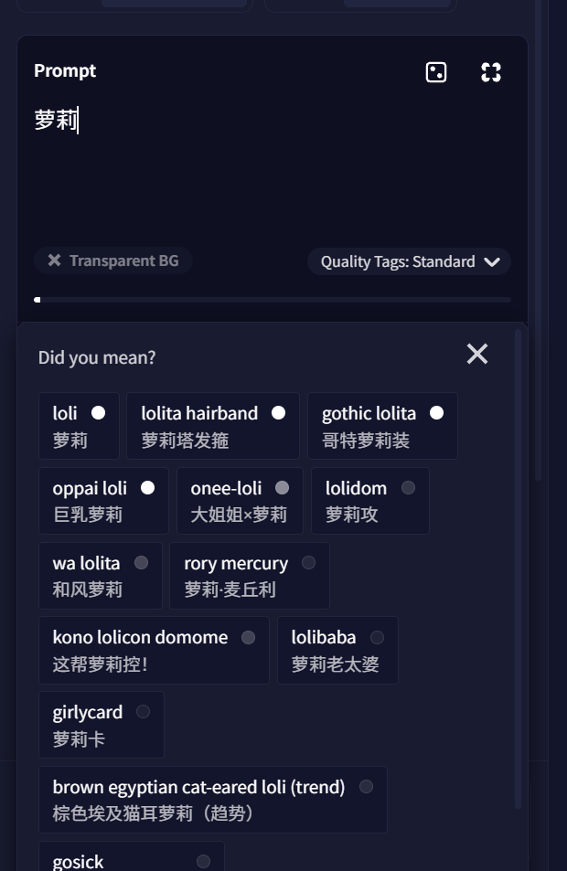

# NovelAI 中文标签联想

在 NovelAI 生图页（novelai.net/image）的提示词框里：

- **输入中文就能联想英文标签**：例如输入「黑丝」会出现 black thighhighs / black pantyhose，点选或用方向键 + 回车选中后插入英文标签。
- **英文联想附中文释义**：输入英文时，NovelAI 原生联想的每一项下面都会多一行中文。
- **全角逗号自动转半角**：NovelAI 只把半角逗号当作标签分隔符，中文输入法打出的「，」会被转成 `, `。不转的话，「长发，猫耳」会被当成一个标签，点选联想时前面的「长发，」也会被一起替换掉。



## 安装

1. 安装 [Tampermonkey](https://www.tampermonkey.net/) 或 Violentmonkey。
   新版 Chrome 需要在扩展详情页打开「允许运行用户脚本」（或在 `chrome://extensions` 打开开发者模式），否则用户脚本不会运行。
2. 把 `dist/novelai-zh-tags.user.js` 装进脚本管理器，任选一种方式：
   - 在 Tampermonkey 面板里「添加新脚本」，粘贴整个文件内容后保存；
   - 或者在扩展详情页给 Tampermonkey 打开「允许访问文件网址」，再把这个文件拖进浏览器，在弹出的安装页点安装。
3. 刷新 NovelAI 页面。

升级时直接用新文件内容替换原脚本，不要新旧两份同时启用。

## 原理

NovelAI 对含汉字或假名的输入片段会以 `lang=jp` 请求 `image.novelai.net/ai/generate-image/suggest-tags`，返回 `[{jp_tag, en_tag, power}]`，面板显示「英文标签 + 本地语副标题」，点选后插入英文标签。

脚本拦截 `fetch`：只含汉字、不含假名的请求改由内置中文词典应答，并把中文放在 `jp_tag` 里，所以显示、点选和键盘操作都走 NovelAI 自己的逻辑。本地词典查不到时，会回退到 NovelAI 自带的日文匹配，能翻译的副标题也换成中文。含假名的日文输入原样交给 NovelAI。英文输入的联想通过 MutationObserver 在每一项下补一行中文。

NovelAI 拼查询串时用的是「光标前的旧文本 + 新输入」。微软拼音这类会把拼音写进编辑器的输入法，上屏时查询会变成 `luo'li萝莉`。所以脚本不用请求里的 `prompt` 参数，而是读取光标前的实际文本作为片段。组字过程中触发的联想会先挂起，等上屏后再按实际文本回答，选字时停顿不会冒出拼音的乱联想。

检索按「精确 > 前缀 > 包含 > 宽松（字间最多隔 3 个字）」匹配，再结合 danbooru 使用次数综合排序。单次检索约 3 ms，词典约 7.5 万条，页面空闲时解析，约 120 ms。

## 词典

- 以 [ame-la/danbooru-tags-data-zh](https://huggingface.co/datasets/ame-la/danbooru-tags-data-zh) 为基础：社区通用译名，附带日文原名、昵称、旧译名等别名（如「二小姐」→ flandre scarlet，「黑丝」→ black pantyhose）。它是 AI 批量生成、以 Danbooru wiki 为依据的数据，不是人工翻译。
- `data/zh-curated.csv`：在此基础上的审定结果，涉及 8,341 个标签（通用 5,407、角色 2,447、作品 469、元标签 18）。
  - 审定范围是词典里全部 75,071 个 Danbooru 标签（通用 30,693、角色 35,384、作品 8,414、元标签 580）。按使用次数分批导出现有译名，并列出 [EhTagTranslation](https://github.com/EhTagTranslation/Database)、[标签超市](https://github.com/wfjsw/danbooru-diffusion-prompt-builder) 和旧人工词典里的对应译名，逐条读过后改动有问题的条目。没有改的条目，是认为现有译名可用，或者没有把握改。
  - 纠正错译（covered nipples「遮挡乳头」→「激凸」、grey nails「灰指甲」→「灰色指甲」、canteen「食堂」→「军用水壶」），换成更常用的叫法（cowboy shot「牛仔构图」→「七分身」、hair between eyes「眉心垂发」→「眼间刘海」）。
  - 按规则统一用词：眼睛颜色写「X瞳」，choker「颈圈」与 collar「项圈」区分，aqua 译「水蓝」，leotard 译「紧身衣」，「高开叉」改为「高开衩」等。
  - 角色名的统一规则：
    - 有官方或通行中文译名的用中文。只有日文假名的名字改写成罗马字或「汉字+罗马字」（如「宫胁Sana」），只有韩文的改写成罗马字，繁体字和日文汉字改成简体。
    - 画师原创角色在括号里注明画师，如「玛琳（ahute）」；同名角色加作品名区分。
    - 换装、版本变体与本体用同一个名字，服饰编号写成「第十二套服饰」。
    - FGO 变体统一为「名（泳装Class·第N再临）（Fate系列）」，职阶沿用国服的英文写法（Saber、Ruler 等）。宝可梦统一写「（Sygna套装）」，马里奥系列用任天堂官方的「马力欧」。
  - 被替换的旧译名会自动保留为检索词，用旧叫法仍然搜得到；确认是错误的检索词（如把 kanagata sugumi 关联到「金潟直美」）已删除。
  - 审定由 Claude 完成，参考了上面这些人工来源和 Danbooru wiki 释义，但没有经过人工校对。冷门角色多半只能按读音或字面处理，错误在所难免；发现错误可以写进 `data/zh-override.csv` 自行修正。
- `data/zh-ehtag.csv`：EhTagTranslation 的人工译名，对齐到 Danbooru 标签后作为补充检索词，共 2,032 条，如 dark skin「黑皮」、school swimsuit「死库水」。
- 不收录画师：NovelAI V5 的联想里查不到 Danbooru 画师。
- 标签名以 2026 年的 Danbooru 为准。我用 NovelAI 自己的联想接口抽样核实过，NovelAI V5 认识这些新名字；唯一不认的 `qipao` 已在 `data/novelai-rename.csv` 里换回 `china_dress`。
- Danbooru 已删除或改名、但 NovelAI 还认识的旧标签（black footwear、otoko no ko 等），会用旧人工词典的译名补上，英文联想里出现时也能显示中文。
- 用 V5 Curated（审核版）时，NovelAI 的联想里没有 NSFW 标签，但本脚本的中文联想不区分模型，仍会给出这类标签。

## 自定义词典

需要 Node.js 18 或更高版本。

- `data/zh-override.csv`：`标签,译名`，替换某个标签的显示译名（修正错误翻译），优先级最高。
- `data/zh-curated.csv`：`标签,译名,补充检索词`，审定结果。译名留空表示只补检索词；检索词用 `/` 分隔，前面加 `-` 表示删掉一个错误的检索词（如 `fear_kubrick,,-害怕侧目`）。
- `data/zh-extra.csv`：`标签,词1/词2`，追加检索词（俗称、简称），不改变显示内容。词表里没有的标签也会收录，比如 NovelAI 的质量词 masterpiece。
- `data/novelai-rename.csv`：`Danbooru新名,NovelAI用的名字`，NovelAI 不认识新名字时输出旧名字。

标签用 danbooru 写法，空格或下划线都可以，别名会自动归并到正式标签。改完后执行：

```sh
npm run build            # 生成 dist/novelai-zh-tags.user.js 和 dist/zh-tags.tsv
npm test                 # 检索质量回归测试
node scripts/test.mjs 黑丝 刘海    # 查看某些词的联想结果
npm run build -- --refresh         # 重新下载上游词典
```

## 已知限制

- NovelAI 只在片段长度为 2–20 个字符时才发起联想，所以单字（如「猫」）不会触发。
- 只支持简体中文；繁体字大多会走 NovelAI 的日文匹配。
- 只收录 Danbooru 上图片数大于 50 的标签；NovelAI 联想里更冷门的标签没有中文释义。
- 抽样核实时，2024 年以后新出现的标签约八成能在 NovelAI 联想里查到，其余（多为冷门角色）NovelAI 可能不认识。
- 依赖 NovelAI 当前的接口格式和 `.image-prompt-suggestions` 面板结构，NovelAI 改版后可能需要更新脚本。

## 数据来源与许可

- 译名、别名、使用次数：[ame-la/danbooru-tags-data-zh](https://huggingface.co/datasets/ame-la/danbooru-tags-data-zh)（[GitHub](https://github.com/amenorira/danbooru-tags-data-zh)），MIT
- 补充检索词：[EhTagTranslation/Database](https://github.com/EhTagTranslation/Database)，**CC BY-NC-SA 3.0**
- 补充检索词和旧标签译名：[byzod/a1111-sd-webui-tagcomplete-CN](https://github.com/byzod/a1111-sd-webui-tagcomplete-CN)，MIT
- 旧标签名（用于识别改名）：[DominikDoom/a1111-sd-webui-tagcomplete](https://github.com/DominikDoom/a1111-sd-webui-tagcomplete)，MIT
- 审定时参考了[标签超市](https://github.com/wfjsw/danbooru-diffusion-prompt-builder)（AGPL-3.0），但没有把它的数据并入词典。

`data/zh-ehtag.csv` 和 `data/zh-curated.csv` 含 EhTagTranslation 的派生内容，内嵌这些数据的 `dist/novelai-zh-tags.user.js` 也一样，因此按 CC BY-NC-SA 3.0 提供：转发需署名，不得商用，修改后须以相同许可发布。自己使用不受影响。
